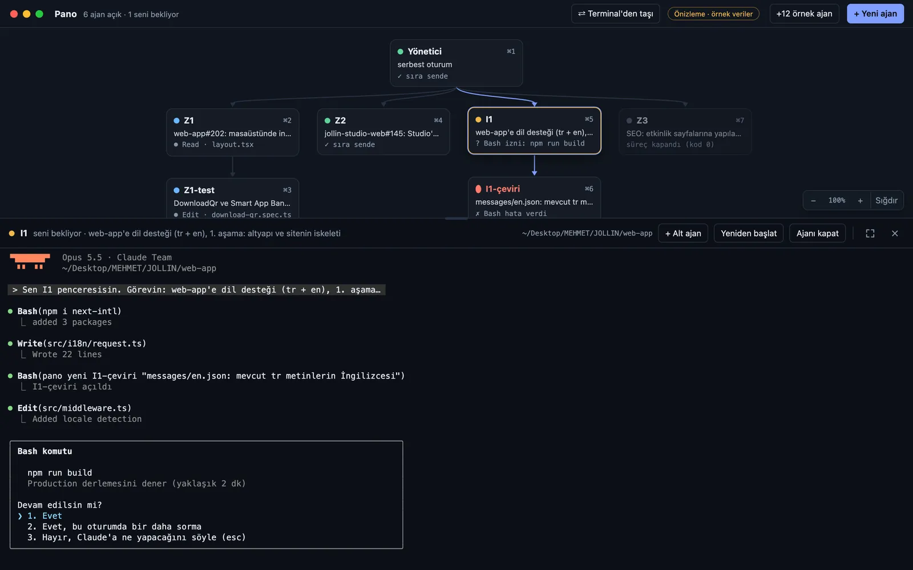
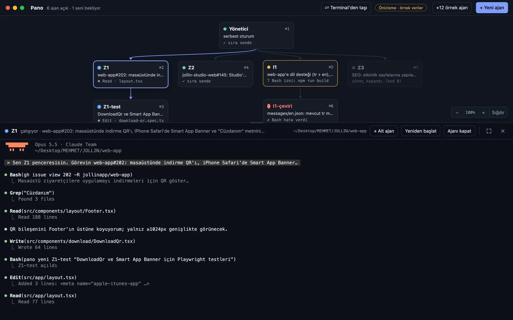
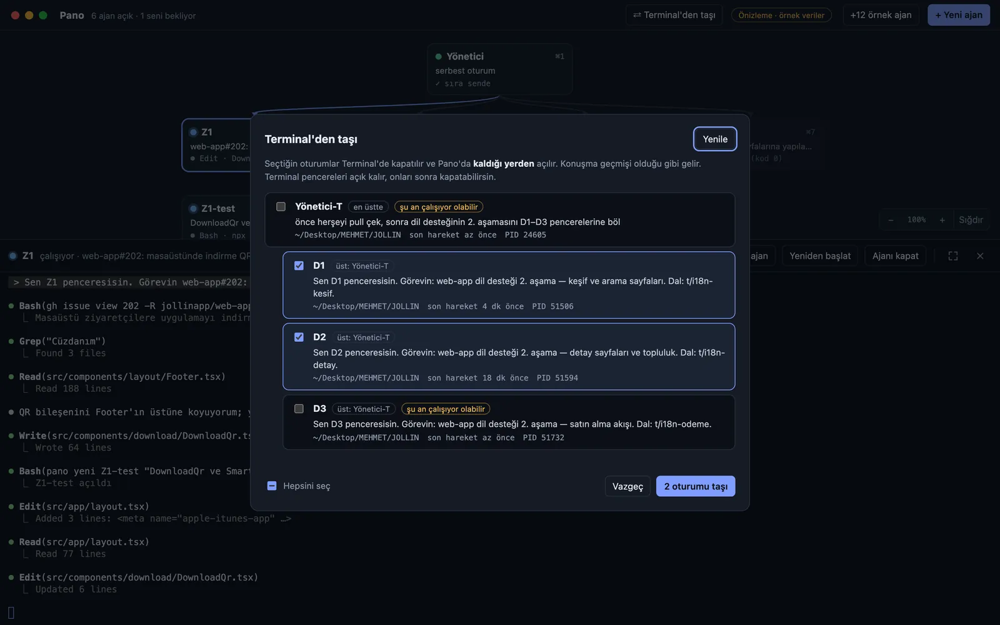

# Pano

**Birden fazla Claude Code ajanını tek pencereden yöneten masaüstü uygulaması.**

Büyük bir işi birbirinden bağımsız parçalara bölüp her parçayı ayrı bir Claude Code ajanına paralel yazdırıyorum. Terminal sekmeleri arasında kaybolmamak için Pano'yu yazdım: ajanlar kimin kimin altında açıldığını gösteren bir ağaçta duruyor, her birinin kendi terminali var, hangisinin çalıştığı, onay beklediği ya da bitirdiği anlık görünüyor.

Kişisel kullanım için tek başıma geliştirdiğim bir araç; kendisi de Claude Code ile geliştirildi.



## Ne yapıyor?

- **Ajan ağacı:** Üst/alt ajan ilişkileri yakınlaştırılabilir, sürüklenebilir bir ağaçta. Her düğümde ajanın durumu ve son yaptığı iş (`› kullanıcı mesajı`, `Edit app.js`, `✓ sıra sende`).
- **Gömülü terminal:** Her ajan `node-pty` + `xterm.js` ile gerçek bir terminalde çalışan `claude` süreci. Tam ekran, gizleme ve `⌘1–9` kısayolları.
- **Ajanlar kendi alt ajanlarını açabiliyor:** Her ajana sistem notu olarak `pano` komutu öğretiliyor. Ajan işi bölmek isterse Bash'ten `pano yeni <AD> "<görev>"` çalıştırıyor, alt ajan Pano'da onun altında açılıyor.
- **Anlık durum takibi:** Claude Code hook'ları (`UserPromptSubmit`, `PreToolUse`, `PostToolUseFailure`, `Notification`, `Stop`) olayları Pano'ya bildiriyor. Onay bekleyen ajan için masaüstü bildirimi ve Dock rozeti.
- **Terminalden taşıma:** Başka bir terminalde açık Claude oturumlarını konuşma geçmişiyle birlikte Pano'ya alıp kaldığı yerden sürdürme (`claude --resume`).



## Mimari

```
┌──────────── Electron ana süreç (main.js) ────────────┐
│  node-pty ile her ajan: zsh -lic "claude ..."        │
│  Yerel HTTP API: 127.0.0.1:<rastgele port>           │
│    POST /ajan    alt ajan aç                          │
│    POST /gonder  bir ajana mesaj yaz                  │
│    GET  /ajanlar ajanlar ve durumları                 │
│    POST /olay    hook olayı (durum güncellemesi)      │
│  Her istek X-Pano-Jeton başlığıyla doğrulanır         │
└───────▲──────────────────────▲────────────────────────┘
        │ pano CLI (bin/pano)  │ hooks/durum.sh
        │ ajanın içinden       │ Claude Code hook'u
   ┌────┴──────────────────────┴────┐
   │      Claude Code ajanları       │
   └─────────────────────────────────┘
          ▲ IPC (preload.js)
   ┌──────┴───────────────────────────┐
   │ Arayüz (renderer/): ağaç + xterm │
   └──────────────────────────────────┘
```

Güvenlik tarafında aldığım kararlar:

- API sadece `127.0.0.1`'i dinliyor ve her açılışta rastgele bir port ile rastgele bir jeton üretiyor. Jeton yalnızca Pano'nun açtığı ajanların ortam değişkenlerine veriliyor, yani makinedeki başka bir süreç ajan açamıyor.
- Hook betiği Pano dışındaki Claude oturumlarında hiçbir şey yapmıyor; normal kullanımı etkilemiyor.
- Pano bir Claude oturumunun içinden başlatılırsa o oturumun `CLAUDE_CODE_*` değişkenleri alt ajanlara sızmıyor.

## Kurulum (macOS)

Gereksinimler: Node.js 20+, [Claude Code](https://claude.com/claude-code) (`claude` komutu PATH'te).

```bash
npm install        # node-pty, Electron için otomatik yeniden derlenir
npm start
```

İlk açılışta `pano` CLI'ı ve hook betiği `~/.claude/pano/` altına kopyalanır. Durum takibi için `~/.claude/settings.json` dosyasına şu hook'ları ekle:

```json
{
  "hooks": {
    "UserPromptSubmit":   [{ "hooks": [{ "type": "command", "command": "~/.claude/pano/durum.sh >/dev/null 2>&1 || true" }] }],
    "PreToolUse":         [{ "hooks": [{ "type": "command", "command": "~/.claude/pano/durum.sh >/dev/null 2>&1 || true" }] }],
    "PostToolUseFailure": [{ "hooks": [{ "type": "command", "command": "~/.claude/pano/durum.sh >/dev/null 2>&1 || true" }] }],
    "Notification":       [{ "hooks": [{ "type": "command", "command": "~/.claude/pano/durum.sh >/dev/null 2>&1 || true" }] }],
    "Stop":               [{ "hooks": [{ "type": "command", "command": "~/.claude/pano/durum.sh >/dev/null 2>&1 || true" }] }]
  }
}
```

Yeni ajanların varsayılan klasörü ev dizinidir; değiştirmek için `PANO_KLASOR=/yol/proje npm start`.

Uygulama paketi: `npm run paketle` → `dist/mac-arm64/Pano.app`.

## Ajanın içinden kullanım

```
pano yeni <AD> "<görev>" [--klasor <yol>]   Altına yeni bir Claude ajanı açar
pano liste                                  Ajanları ve durumlarını gösterir
pano gonder <AD> "<mesaj>"                  Bir ajana mesaj yazar
```



## Teknolojiler

Electron · Node.js · node-pty · xterm.js · Claude Code hooks · Bash

## Durum

Kişisel kullanım aracı (v0.1). Şimdilik yalnızca macOS'ta denendi.
